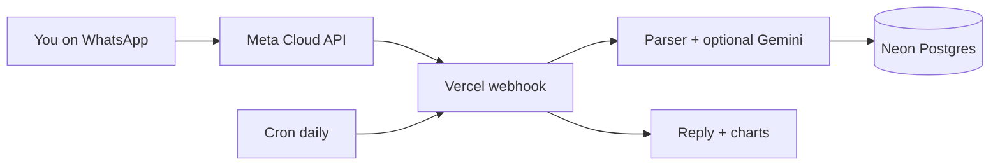

<p align="center">
  
</p>


# Hisab On Tip 💸

**Your daily money diary on WhatsApp — no app, no signup.**

Type kharcha like you text a friend. Get summaries, charts, budgets, and savings goals back in the chat. Built for Pakistan (banks, wallets, Urdu numbers) and free to self-host.

<p align="center">
  <a href="https://nextjs.org/"></a>
  <a href="https://vercel.com/"></a>
  <a href="https://neon.tech/"></a>
  
  
</p>

---

## Table of contents

- [Why Hisab On Tip?](#-why-hisab-on-tip)
- [How it works](#-how-it-works)
- [Try it (users)](#-try-it-users)
- [What you can do](#-what-you-can-do)
- [Commands cheat sheet](#-commands-cheat-sheet)
- [Banks & wallets](#-banks--wallets-pakistan)
- [Voice notes](#-voice-notes)
- [Self-host setup](#-self-host-setup)
- [Troubleshooting](#-troubleshooting)
- [Privacy & limits](#-privacy--limits)
- [Developers](#-developers)

---

## ✨ Why Hisab On Tip?

| | |
|---|---|
| 📱 **Zero friction** | Open WhatsApp → type `chai 50` → done |
| 🇵🇰 **Local-first** | `2k`, `dhai hazar`, `kal`, `چائے 50`, Meezan / Easypaisa tags |
| 📊 **Actually useful** | Pie + bar charts, today / week / month, balance |
| 🎯 **Stay on budget** | Category budgets + warnings at 80% / 100% |
| 🏦 **Goals** | `goal laptop 100000` + `save 5000 laptop` |
| 🔒 **You own the data** | Postgres on Neon — export CSV anytime |
| 🌙 **Roman Urdu vibes** | Pick **English**, **Roman Urdu**, or **اردو** on first `hi` |

---

## 🔄 How it works



1. You message the bot (text or voice).
2. Meta sends a signed webhook to your app.
3. Expenses are parsed, categorised, and saved.
4. You get a short confirmation + today/month totals.
5. Type **`report`** or tap the **Reports** menu for charts.

---

## 🚀 Try it (users)

> **First time?** Send **`hi`** to the bot number (not only Meta’s dashboard “Hello World” test — that’s Meta’s template).

**Onboarding**

1. Send `hi`
2. Tap **English** · **Roman Urdu** · **اردو**
3. Read the welcome — your WhatsApp **name** is used in the greeting
4. Save the chat as **Hisab On Tip** on your phone (test numbers often show `+1 (555)…` until you use your own business line)

**Everyday use**

| You send | What happens |
|----------|----------------|
| `chai paratha 110` | Expense logged ✅ + today/month line |
| `petrol 2000 meezan` | Expense + **Meezan** tag |
| `salary 150000` | Income logged 💰 |
| `chai 40 aur rickshaw 200` | Two expenses in one message |
| `kal biryani 450` | Dated for yesterday |
| `report` | Report menu (buttons) 📊 |
| `help` | Full guide + menu |
| `undo` | Removes last entry |

**Example chat**

```
You:   hi
Bot:   [Language buttons]
You:   [English]
Bot:   Assalam o Alaikum, Ali! ✨
       Hisab On Tip — your daily money diary...

You:   chai 50 cash
Bot:   ✅ Chai — Rs 50 (Food) · Cash
       Today: Rs 50 | Month: Rs 50

You:   report
Bot:   [Reports menu → Today]
       📊 Today — text + chart image
```

---

## 💡 What you can do

### Log money (natural language)

- Amounts: `5k`, `1.5k`, `2 lakh`, `paanch sau`, `ہزار`, Urdu digits
- Multi-line or `aur` / `and`: several items in one message
- Income vs expense: `ali ne diye 5000` (in) vs `ali ko diye 5000` (out)
- Savings: `save 5000 laptop`
- Typos often still work: `pertol`, `grocry`

### Reports & charts

- **On demand:** `today`, `week`, `month`, `last month`, `balance`, or **report menu**
- **Automatic (if you messaged in last ~23h):** daily nudge/summary ~**22:00 Karachi**, weekly on **Sunday**, monthly on the **1st**

### Budgets & goals

- `budget food 20000` — warn near / over limit
- `goal laptop 100000` — track progress when you `save … laptop`

### Fix mistakes

- `undo` · `edit 120` · `last 5`
- `category chai food` — teach the bot your words

### Data & privacy

- `export` — CSV download link
- `delete my data` → type `confirm` within 10 minutes (not by voice)

---

## 📋 Commands cheat sheet

| Topic | Examples |
|-------|----------|
| **Reports** | `report`, `today`, `week`, `month`, `last month`, `balance` |
| **Lists** | `last 5`, `budget`, `goals` |
| **Planning** | `budget food 20000`, `goal laptop 100000`, `save 3000 laptop` |
| **Fix** | `undo`, `edit 120` |
| **Learn** | `category chai food` |
| **Language** | `english`, `roman`, `urdu` |
| **Reminders** | `report on`, `report off` |
| **Help** | `help` |

---

## 🏦 Banks & wallets (Pakistan)

Tag **how you paid** at the **end** of a message (applies to all items in that message):

```
petrol 2000 meezan
chai 50 cash
lunch 450 easypaisa
```

**Recognised (examples):** Cash, Meezan, HBL, UBL, MCB, NBP, Alfalah, Faysal, Askari, Allied, Bank Al Habib, Habib Metro, BankIslami, BOP, Soneri, JS Bank, Dubai Islamic, Easypaisa, JazzCash, SadaPay, NayaPay, Upaisa, cards, and more.

Full list: type **`help`** in the bot.

---

## 🎙️ Voice notes

1. Add `GEMINI_API_KEY` on Vercel ([Google AI Studio](https://aistudio.google.com)) and redeploy.
2. Send a voice note: *"chai paratha ek sau dus"* or *"petrol 2000 jazzcash"*.
3. Bot shows **🎙️ what it heard**, then logs it like typed text.
4. Max ~2 MB (~2 min). Use `undo` if it misheard.

---

## 🛠️ Self-host setup

~30–45 minutes. Stack: **Next.js** · **Vercel** · **Neon** · **Meta WhatsApp Cloud API** · **QuickChart** · optional **Gemini**.

<details>
<summary><b>1️⃣ Database (Neon)</b></summary>

1. Create a project at [neon.tech](https://neon.tech) (pooling enabled).
2. Run all of [`db/schema.sql`](./db/schema.sql) in the SQL Editor.
3. Copy the **pooled** connection string → `DATABASE_URL`.

</details>

<details>
<summary><b>2️⃣ Meta WhatsApp</b></summary>

1. [developers.facebook.com](https://developers.facebook.com) → App **Business** → add **WhatsApp**.
2. Copy **Phone number ID**, add your phone as a **test recipient**, verify OTP.
3. **App secret** → `META_APP_SECRET`.
4. **System user** permanent token → `whatsapp_business_messaging` + `whatsapp_business_management` → `WHATSAPP_TOKEN`.
5. **WABA subscribe:** `POST /{WABA_ID}/subscribed_apps` so your app receives inbound messages (see troubleshooting).

</details>

<details>
<summary><b>3️⃣ Vercel</b></summary>

1. Import this repo → add env vars from [`.env.example`](./.env.example).
2. Set `APP_URL` to your deployment URL.
3. Random secrets: `WHATSAPP_VERIFY_TOKEN`, `CRON_SECRET`, `EXPORT_SECRET`.
4. Deploy.

</details>

<details>
<summary><b>4️⃣ Webhook</b></summary>

1. WhatsApp → **Configuration** → Webhook.
2. URL: `https://YOUR-APP.vercel.app/api/webhook`
3. Verify token = `WHATSAPP_VERIFY_TOKEN`
4. Subscribe field **`messages`**.

</details>

<details>
<summary><b>5️⃣ Test</b></summary>

From your phone, send **`hi`** to the business number → language buttons → welcome → `chai 50` → `report`.

Optional: `NEXT_PUBLIC_WA_NUMBER=923xxxxxxxxx` for the landing page WhatsApp button.

</details>

---

## 🩺 Troubleshooting

| Problem | What to check |
|---------|----------------|
| Webhook won’t verify | Token exact match; redeploy after env changes |
| No reply on real messages | `messages` subscribed; WABA `subscribed_apps`; number on test recipient list |
| 401 on webhook | `META_APP_SECRET` = App secret, not token |
| Send fails 401/190 | Use **permanent** system user token |
| Nothing saves | `DATABASE_URL` + schema applied in Neon |
| No charts | QuickChart blocked/rate limit — text still works |
| Voice off / fail | `GEMINI_API_KEY` + redeploy; check quota |
| Daily report missing | You must message within **24h** (WhatsApp rule) |
| Meta “Hello World” only | Dashboard test template — user must send **`hi`** for real onboarding |
| Name stuck as +1 (555) | **Test number profile is locked** — save contact as “Hisab On Tip”; real number for display name |

---

## 🔐 Privacy & limits

- **Privacy policy:** deploy with [`/privacy`](./src/app/privacy/page.tsx) — add your contact email before going public (Meta requires a URL).
- **Test mode:** only a few verified recipient numbers; Meta’s test line can’t edit business profile.
- **ALLOWED_PHONES:** optional env lock while developing.
- **Cron:** `vercel.json` → 17:00 UTC ≈ 22:00 Karachi (Hobby cron ±~1h).
- **Vercel Hobby:** non-commercial use if you charge users, move to a paid/commercial host.

---

## 👩‍💻 Developers

```bash
git clone https://github.com/Osama710/HisabOnTip.git
cd HisabOnTip
npm install
npm test          # parser, chat flow, DB tests
npm run typecheck
npm run dev
```

Local webhook: tunnel (**ngrok** / **Cloudflare Tunnel**) → `localhost` + Meta callback.

**Layout**

```
src/app/api/webhook/     verify + inbound messages
src/app/api/cron/daily/  scheduled reports
src/app/api/export/      signed CSV
src/lib/parser/          amounts, dates, categories, commands
src/lib/handle.ts        orchestration + onboarding
src/lib/i18n.ts          EN / Roman / Urdu copy
db/schema.sql            Postgres schema
test/                    Vitest suites
```

---

## ⭐ Star & share

If **Hisab On Tip** helps you track roz ka kharcha, star the repo and share with someone who still uses Notes app for expenses.

**Assalam o Alaikum — ab hisaab sirf ek `hi` door.** 💚